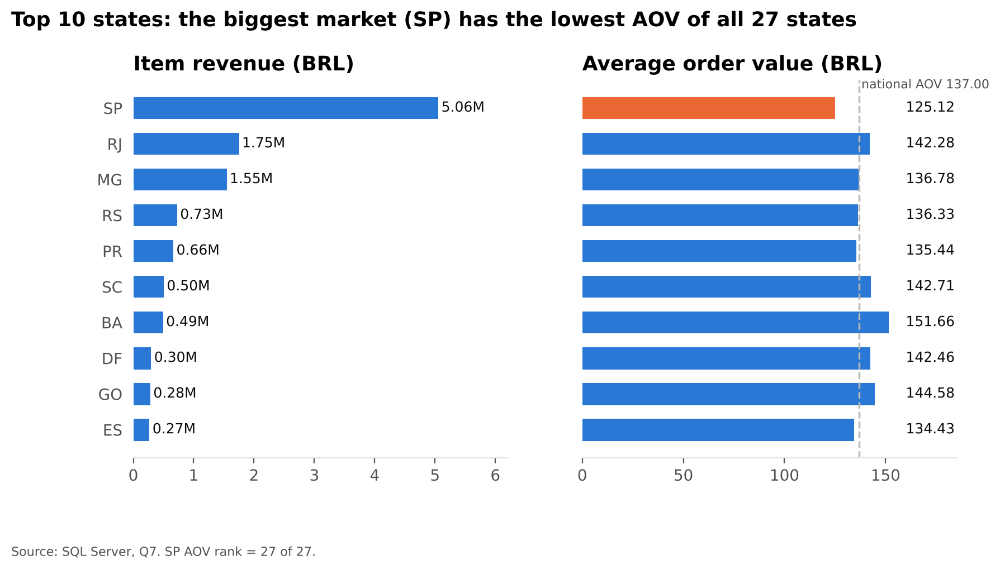

# Business Questions and Answers

E-commerce Business Performance & Customer Intelligence: all 15 questions answered with SQL Server (T-SQL) on the Olist dataset. Each answer shows the result, what it means, and the SQL (click "View the SQL" to expand). Full script: [`sql/03_analysis.sql`](sql/03_analysis.sql).

**Headline numbers:** 96,211 completed orders · 93,104 customers · BRL 13.18M item revenue · BRL 137.00 average order value · 3.00% repeat customers · 93.21% on-time delivery

## Definitions used throughout

| Term | Definition | Why |
|---|---|---|
| Completed (qualifying) sale | order_status = 'delivered', at least one item row, purchased Jan 2017 to Aug 2018 | Undelivered orders can still be cancelled; delivered-only keeps revenue, reviews and delivery on one population. |
| Analysis window | Jan 2017 to Aug 2018 | 2016 has 329 orders (with a gap in November) and Sep-Oct 2018 only 20, which would distort growth rates. |
| Item revenue | SUM(order_items.price), freight excluded | payment_value includes instalment interest and vouchers, so it does not reconcile to item prices. |
| Unit | one row in order_items | The dataset has no quantity column. |
| Customer | customer_unique_id | customer_id changes with every order: 99,441 ids vs 96,096 real customers. |
| Late delivery | delivered DATE after estimated DATE | The estimate is a date, so comparing timestamps would overstate lateness. |
| Missing values | kept as NULL, never replaced with 0 | A missing delivery date means "not delivered", not "delivered instantly". |

## Contents

- Q1. Overall quality of the raw dataset
- Q2. Share of orders by status
- Q3. Definition of a completed sale
- Q4. Overall sales KPIs
- Q5. Best and weakest month and quarter
- Q6. Month-over-month revenue growth
- Q7. Revenue and AOV by state
- Q8. Top 10 categories by item revenue
- Q9. Products by units and by revenue
- Q10. High-volume categories with weak reviews or slow delivery
- Q11. Repeat purchasers
- Q12. Top 20 customers by spend
- Q13. RFM segmentation
- Q14. Delivery performance against the estimated date
- Q15. Three evidence-based business opportunities

---

## Part A: Data quality and definitions

### Q1. Overall quality of the raw dataset

**Question:** What is the overall quality of the raw dataset? Count rows, find missing values, check key uniqueness and duplicates, and find invalid dates, prices or inconsistent statuses.

**Answer:** All nine tables loaded in full. Keys are unique everywhere except reviews, there are no invalid prices, payments or review scores, and every issue found is explainable and handled without affecting the analysis.

**Row counts**

| Table | Rows |
|---|---|
| customers | 99,441 |
| geolocation | 1,000,163 |
| orders | 99,441 |
| order_items | 112,650 |
| order_payments | 103,886 |
| order_reviews | 99,224 |
| products | 32,951 |
| sellers | 3,095 |
| product_category_name_translation | 73 (after adding 2 missing translations) |

**Missing values in important fields**

| Field | NULL rows | NULL % | Treatment |
|---|---|---|---|
| order_reviews.review_comment_message | 58,256 | 58.71 | Expected; only review_score is used |
| orders.order_delivered_customer_date | 2,965 | 2.98 | 2,957 explained by order status (kept NULL); 8 delivered anomalies excluded from delivery metrics |
| products.product_category_name | 610 | 1.85 | Labelled 'unknown' |
| orders.order_delivered_carrier_date | 1,783 | 1.79 | Not used |
| orders.order_approved_at | 160 | 0.16 | Not used |
| products.product_weight_g | 2 | 0.01 | Not used |
| estimated date, customer id, price, freight, payment value, review score | 0 | 0.00 | None needed |

**Key uniqueness and duplicates**

| Key checked | Total rows | Distinct keys | Duplicates |
|---|---|---|---|
| orders (order_id) | 99,441 | 99,441 | 0 |
| customers (customer_id) | 99,441 | 99,441 | 0 |
| products (product_id) | 32,951 | 32,951 | 0 |
| sellers (seller_id) | 3,095 | 3,095 | 0 |
| order_items (order_id, order_item_id) | 112,650 | 112,650 | 0 |
| order_payments (order_id, payment_sequential) | 103,886 | 103,886 | 0 |
| order_reviews (review_id), not a clean key | 99,224 | 98,410 | 814 |
| order_reviews (order_id), orders with more than one review | 99,224 | 98,673 | 551 |
| translation (category name) | 73 | 73 | 0 |

**Invalid or inconsistent values (rows affected)**

| Check | Rows | Treatment |
|---|---|---|
| carrier pickup before approval | 1,359 | Flagged, not deleted; field unused |
| orders with no items at all | 775 | Excluded from sales (no basket, no sale) |
| customer delivery before carrier pickup | 23 | Flagged, not deleted; field unused |
| payments with value 0 | 9 | Immaterial; revenue uses item price |
| status delivered but no delivery date | 8 | Stay in sales; excluded from delivery metrics |
| status canceled but has delivery date | 6 | Excluded from sales (status is canceled) |
| products with weight <= 0 | 4 | Immaterial |
| payments with installments < 1 | 2 | Immaterial |
| orders with no payment record | 1 | Excluded from payment analysis |
| all other checks (18 in total): delivered/approved/estimate before purchase, score outside 1-5, price <= 0, freight < 0, payment < 0, in-progress with delivery date | 0 | None needed |

**Findings and notes**

- **Geolocation** has 1,000,163 rows for only 19,015 zip prefixes, and 261,831 rows (26.2%) are exact duplicates. No question needs it, because the customer state comes from `customers`.
- **customer_id vs customer_unique_id:** 99,441 vs 96,096. Every customer question uses `customer_unique_id`.
- **Reviews:** 551 orders have more than one review, and 768 orders have none. Reviews are deduplicated to the latest per order and always LEFT JOINed.
- **Payments do not reconcile to item totals** (differences in both directions, from instalment interest and vouchers), so revenue is defined as item `price`.
- Date range: 2016-09-04 to 2018-10-17. Every order has an estimated delivery date, and there are 0 orders delivered or approved before purchase.

*Approach:* Row counts with UNION ALL; NULL profiling with SUM(CASE WHEN ... IS NULL); key checks with COUNT(*) minus COUNT(DISTINCT); orphan-key checks with LEFT JOIN ... IS NULL (all 0); range and date-logic checks.

<details>
<summary>View the SQL for Q1</summary>

```sql
/* ---------- Q1. Overall quality of the raw dataset ---------- */

-- 1a. Row counts (use whichever geolocation table holds the full file)
SELECT 'customers' AS tbl, COUNT(*) AS n FROM dbo.customers UNION ALL
SELECT 'geolocation',      COUNT(*) FROM dbo.geolocation_main UNION ALL
SELECT 'orders',           COUNT(*) FROM dbo.orders UNION ALL
SELECT 'order_items',      COUNT(*) FROM dbo.order_items UNION ALL
SELECT 'order_payments',   COUNT(*) FROM dbo.order_payments UNION ALL
SELECT 'order_reviews',    COUNT(*) FROM dbo.order_reviews UNION ALL
SELECT 'products',         COUNT(*) FROM dbo.products UNION ALL
SELECT 'sellers',          COUNT(*) FROM dbo.sellers UNION ALL
SELECT 'category_translation', COUNT(*) FROM dbo.product_category_name_translation;

-- 1b. Missing values in important fields
WITH n AS (
    SELECT 'orders.order_approved_at' AS field, COUNT(*) AS total_rows,
           SUM(CASE WHEN order_approved_at IS NULL THEN 1 ELSE 0 END) AS null_rows FROM dbo.orders
    UNION ALL SELECT 'orders.order_delivered_carrier_date', COUNT(*),
           SUM(CASE WHEN order_delivered_carrier_date IS NULL THEN 1 ELSE 0 END) FROM dbo.orders
    UNION ALL SELECT 'orders.order_delivered_customer_date', COUNT(*),
           SUM(CASE WHEN order_delivered_customer_date IS NULL THEN 1 ELSE 0 END) FROM dbo.orders
    UNION ALL SELECT 'orders.order_estimated_delivery_date', COUNT(*),
           SUM(CASE WHEN order_estimated_delivery_date IS NULL THEN 1 ELSE 0 END) FROM dbo.orders
    UNION ALL SELECT 'customers.customer_unique_id', COUNT(*),
           SUM(CASE WHEN customer_unique_id IS NULL THEN 1 ELSE 0 END) FROM dbo.customers
    UNION ALL SELECT 'order_items.price', COUNT(*),
           SUM(CASE WHEN price IS NULL THEN 1 ELSE 0 END) FROM dbo.order_items
    UNION ALL SELECT 'order_items.freight_value', COUNT(*),
           SUM(CASE WHEN freight_value IS NULL THEN 1 ELSE 0 END) FROM dbo.order_items
    UNION ALL SELECT 'order_payments.payment_value', COUNT(*),
           SUM(CASE WHEN payment_value IS NULL THEN 1 ELSE 0 END) FROM dbo.order_payments
    UNION ALL SELECT 'order_reviews.review_score', COUNT(*),
           SUM(CASE WHEN review_score IS NULL THEN 1 ELSE 0 END) FROM dbo.order_reviews
    UNION ALL SELECT 'order_reviews.review_comment_message', COUNT(*),
           SUM(CASE WHEN review_comment_message IS NULL THEN 1 ELSE 0 END) FROM dbo.order_reviews
    UNION ALL SELECT 'products.product_category_name', COUNT(*),
           SUM(CASE WHEN product_category_name IS NULL THEN 1 ELSE 0 END) FROM dbo.products
    UNION ALL SELECT 'products.product_weight_g', COUNT(*),
           SUM(CASE WHEN product_weight_g IS NULL THEN 1 ELSE 0 END) FROM dbo.products
)
SELECT field, total_rows, null_rows,
       CAST(100.0 * null_rows / total_rows AS DECIMAL(6,2)) AS null_pct
FROM n
ORDER BY null_pct DESC;

-- 1c. Key uniqueness and duplicates
SELECT 'orders (order_id)' AS key_checked, COUNT(*) AS total_rows,
       COUNT(DISTINCT order_id) AS distinct_keys,
       COUNT(*) - COUNT(DISTINCT order_id) AS duplicates
FROM dbo.orders
UNION ALL SELECT 'customers (customer_id)', COUNT(*), COUNT(DISTINCT customer_id),
       COUNT(*) - COUNT(DISTINCT customer_id) FROM dbo.customers
UNION ALL SELECT 'products (product_id)', COUNT(*), COUNT(DISTINCT product_id),
       COUNT(*) - COUNT(DISTINCT product_id) FROM dbo.products
UNION ALL SELECT 'sellers (seller_id)', COUNT(*), COUNT(DISTINCT seller_id),
       COUNT(*) - COUNT(DISTINCT seller_id) FROM dbo.sellers
UNION ALL SELECT 'order_items (order_id, order_item_id)', COUNT(*),
       (SELECT COUNT(*) FROM (SELECT DISTINCT order_id, order_item_id FROM dbo.order_items) d),
       COUNT(*) - (SELECT COUNT(*) FROM (SELECT DISTINCT order_id, order_item_id FROM dbo.order_items) d)
FROM dbo.order_items
UNION ALL SELECT 'order_payments (order_id, payment_sequential)', COUNT(*),
       (SELECT COUNT(*) FROM (SELECT DISTINCT order_id, payment_sequential FROM dbo.order_payments) d),
       COUNT(*) - (SELECT COUNT(*) FROM (SELECT DISTINCT order_id, payment_sequential FROM dbo.order_payments) d)
FROM dbo.order_payments
UNION ALL SELECT 'order_reviews (review_id)  - not a clean key', COUNT(*), COUNT(DISTINCT review_id),
       COUNT(*) - COUNT(DISTINCT review_id) FROM dbo.order_reviews
UNION ALL SELECT 'order_reviews (order_id)   - orders with >1 review', COUNT(*), COUNT(DISTINCT order_id),
       COUNT(*) - COUNT(DISTINCT order_id) FROM dbo.order_reviews
UNION ALL SELECT 'translation (category name)', COUNT(*), COUNT(DISTINCT product_category_name),
       COUNT(*) - COUNT(DISTINCT product_category_name) FROM dbo.product_category_name_translation;

-- geolocation: many rows per zip prefix by design, plus exact duplicate rows
SELECT COUNT(*) AS total_rows,
       COUNT(DISTINCT geolocation_zip_code_prefix) AS distinct_zip_prefixes,
       COUNT(*) - (SELECT COUNT(*) FROM (SELECT DISTINCT * FROM dbo.geolocation_main) d) AS exact_duplicate_rows
FROM dbo.geolocation_main;

-- customer_id is per order; customer_unique_id is the real customer
SELECT COUNT(DISTINCT customer_id) AS customer_ids,
       COUNT(DISTINCT customer_unique_id) AS real_customers
FROM dbo.customers;

-- 1d. Invalid or inconsistent values (issue_rows = 0 is good)
SELECT check_name, issue_rows
FROM (
    SELECT 'order_items: price <= 0' AS check_name, COUNT(*) AS issue_rows FROM dbo.order_items WHERE price <= 0
    UNION ALL SELECT 'order_items: freight_value < 0', COUNT(*) FROM dbo.order_items WHERE freight_value < 0
    UNION ALL SELECT 'order_items: order_item_id < 1', COUNT(*) FROM dbo.order_items WHERE order_item_id < 1
    UNION ALL SELECT 'order_payments: payment_value < 0', COUNT(*) FROM dbo.order_payments WHERE payment_value < 0
    UNION ALL SELECT 'order_payments: payment_value = 0', COUNT(*) FROM dbo.order_payments WHERE payment_value = 0
    UNION ALL SELECT 'order_payments: installments < 1', COUNT(*) FROM dbo.order_payments WHERE payment_installments < 1
    UNION ALL SELECT 'order_reviews: score outside 1-5', COUNT(*) FROM dbo.order_reviews WHERE review_score NOT BETWEEN 1 AND 5
    UNION ALL SELECT 'products: weight <= 0', COUNT(*) FROM dbo.products WHERE product_weight_g <= 0
    UNION ALL SELECT 'orders: approved before purchase', COUNT(*) FROM dbo.orders WHERE order_approved_at < order_purchase_timestamp
    UNION ALL SELECT 'orders: carrier pickup before approval', COUNT(*) FROM dbo.orders WHERE order_delivered_carrier_date < order_approved_at
    UNION ALL SELECT 'orders: customer delivery before carrier pickup', COUNT(*) FROM dbo.orders WHERE order_delivered_customer_date < order_delivered_carrier_date
    UNION ALL SELECT 'orders: delivered before purchase', COUNT(*) FROM dbo.orders WHERE order_delivered_customer_date < order_purchase_timestamp
    UNION ALL SELECT 'orders: estimate before purchase', COUNT(*) FROM dbo.orders WHERE order_estimated_delivery_date < order_purchase_timestamp
    UNION ALL SELECT 'orders: status delivered but no delivery date', COUNT(*) FROM dbo.orders
           WHERE order_status = 'delivered' AND order_delivered_customer_date IS NULL
    UNION ALL SELECT 'orders: status canceled but has delivery date', COUNT(*) FROM dbo.orders
           WHERE order_status = 'canceled' AND order_delivered_customer_date IS NOT NULL
    UNION ALL SELECT 'orders: in-progress status but has delivery date', COUNT(*) FROM dbo.orders
           WHERE order_status NOT IN ('delivered','canceled') AND order_delivered_customer_date IS NOT NULL
    UNION ALL SELECT 'orders: no items at all', COUNT(*) FROM dbo.orders o
           WHERE NOT EXISTS (SELECT 1 FROM dbo.order_items i WHERE i.order_id = o.order_id)
    UNION ALL SELECT 'orders: no payment record', COUNT(*) FROM dbo.orders o
           WHERE NOT EXISTS (SELECT 1 FROM dbo.order_payments p WHERE p.order_id = o.order_id)
) x
ORDER BY issue_rows DESC;
-- REPORT NOTE: the dataset has no quantity column, so quantity checks apply to order_item_id.
-- Flag, do not delete: date-sequence anomalies are logged and handled by the qualifying-order rules.
```

</details>

---

### Q2. Share of orders by status

**Question:** What percentage of orders fall into each order status?

**Answer:** 97.02% of orders were delivered. Canceled (0.63%) and unavailable (0.61%) orders together are 1.24%, and 1.74% were still in progress when the data was captured.

**Every status present**

| Order status | Orders | % of orders |
|---|---|---|
| delivered | 96,478 | 97.02 |
| shipped | 1,107 | 1.11 |
| canceled | 625 | 0.63 |
| unavailable | 609 | 0.61 |
| invoiced | 314 | 0.32 |
| processing | 301 | 0.30 |
| created | 5 | 0.01 |
| approved | 2 | 0.00 |

**Grouped**

| Status group | Orders | % of orders |
|---|---|---|
| delivered | 96,478 | 97.02 |
| other (shipped, invoiced, processing, created, approved) | 1,729 | 1.74 |
| canceled | 625 | 0.63 |
| unavailable | 609 | 0.61 |

**Findings and notes**

- Fulfilment is very reliable, so the main operational question is delivery timing (Q14), not failed orders.

*Approach:* COUNT(*) per status with the share calculated as COUNT(*) / SUM(COUNT(*)) OVER ().

<details>
<summary>View the SQL for Q2</summary>

```sql
/* ---------- Q2. Share of orders by status ---------- */

-- Every status present
SELECT order_status,
       COUNT(*) AS orders,
       CAST(100.0 * COUNT(*) / SUM(COUNT(*)) OVER () AS DECIMAL(6,2)) AS pct_of_orders
FROM dbo.orders
GROUP BY order_status
ORDER BY orders DESC;

-- Grouped view: delivered / canceled / unavailable / other
SELECT CASE WHEN order_status IN ('delivered','canceled','unavailable') THEN order_status
            ELSE 'other (in progress)' END AS status_group,
       COUNT(*) AS orders,
       CAST(100.0 * COUNT(*) / SUM(COUNT(*)) OVER () AS DECIMAL(6,2)) AS pct_of_orders
FROM dbo.orders
GROUP BY CASE WHEN order_status IN ('delivered','canceled','unavailable') THEN order_status
              ELSE 'other (in progress)' END
ORDER BY orders DESC;
```

</details>

---

### Q3. Definition of a completed sale

**Question:** How should a completed sale be defined? Document which statuses are included or excluded, how cancelled or undelivered orders are treated, and why a missing value should not automatically become zero.

**Answer:** A completed sale is an order with status 'delivered', at least one item row, purchased between January 2017 and August 2018. This gives 96,211 qualifying orders and leaves out only 2.7% of all item revenue.

**Funnel from all orders to qualifying orders**

| Step | Orders |
|---|---|
| 1. All orders | 99,441 |
| 2. status = delivered | 96,478 |
| 3. ...and has at least one item | 96,478 |
| 4. ...and purchased Jan 2017 to Aug 2018 (QUALIFYING) | 96,211 |

**Item revenue by status (what the definition leaves out)**

| Status | Orders with items | Item revenue (BRL) | % of total | Completed sale? |
|---|---|---|---|---|
| delivered | 96,478 | 13,221,498.11 | 97.28 | Yes |
| shipped | 1,106 | 150,727.44 | 1.11 | No |
| canceled | 461 | 95,235.27 | 0.70 | No |
| invoiced | 312 | 61,526.37 | 0.45 | No |
| processing | 301 | 60,439.22 | 0.44 | No |
| unavailable | 6 | 2,007.69 | 0.01 | No |
| approved | 2 | 209.60 | 0.00 | No |
| **Total** | **98,666** | **13,591,643.70** | **100.00** |  |

**Why NULL must not become 0**

| Calculation | Average delivery days |
|---|---|
| NULLs ignored (correct) | 12.50 |
| NULLs wrongly set to 0 | 12.12 |

**Findings and notes**

- **Included:** delivered orders only. In-progress orders (shipped, invoiced, processing, created, approved) have not completed and can still be cancelled.
- **Excluded:** canceled and unavailable orders. 603 of the 609 unavailable and 164 of the 625 canceled orders have no items at all, so they never had a basket.
- **Revenue left out by the definition:** BRL 370,145.59, which is 2.72% of the BRL 13.59M held in all statuses.
- **The 267 delivered orders outside the window** are dropped only for trend reasons (2016 and Sep-Oct 2018 are too thin).
- **Why not zero:** a missing delivery date means the event has not happened or was not recorded. Setting it to 0 says "delivered instantly": the average falls from 12.50 to 12.12 days, and the 2,965 orders (2.98%) would count as ultra-fast, on-time deliveries. A missing review comment or product weight is likewise unknown, not zero. Keeping NULLs lets aggregates ignore them and keeps denominators honest.

*Approach:* Views v_orders_clean, v_qual_orders, v_qual_items and v_qual_order_rev implement the definition once, so every later query starts from the same population.

<details>
<summary>View the SQL for Q3</summary>

```sql
/* ---------- Q3. Definition of a completed sale ---------- */

-- Funnel from all orders to qualifying orders
SELECT '1. All orders' AS step, COUNT(*) AS orders FROM dbo.orders
UNION ALL SELECT '2. status = delivered', COUNT(*) FROM dbo.orders WHERE order_status = 'delivered'
UNION ALL SELECT '3. ...and has at least one item', COUNT(*) FROM dbo.v_orders_clean
       WHERE order_status = 'delivered' AND is_revenue_order = 1
UNION ALL SELECT '4. ...and purchased Jan 2017 - Aug 2018 (QUALIFYING)', COUNT(*) FROM dbo.v_qual_orders;

-- Item revenue sitting in each status (what the definition leaves out)
SELECT o.order_status,
       COUNT(DISTINCT o.order_id) AS orders,
       SUM(i.price) AS item_revenue
FROM dbo.orders o
JOIN dbo.order_items i ON i.order_id = o.order_id
GROUP BY o.order_status
ORDER BY item_revenue DESC;

-- Why NULL must not become 0: filling missing delivery dates with 0 drags the average down
SELECT AVG(CAST(DATEDIFF(DAY, order_purchase_timestamp, order_delivered_customer_date) AS FLOAT)) AS avg_days_ignoring_nulls,
       AVG(CAST(COALESCE(DATEDIFF(DAY, order_purchase_timestamp, order_delivered_customer_date), 0) AS FLOAT)) AS avg_days_if_nulls_set_to_0
FROM dbo.orders;
```

</details>

---

## Part B: Sales and revenue performance

### Q4. Overall sales KPIs

**Question:** What are the overall sales KPIs? Calculate distinct orders, distinct customers, item revenue, average order value (AOV) and total units sold, and define each metric and its denominator.

**Answer:** From January 2017 to August 2018 the marketplace completed 96,211 orders for 93,104 customers, generating BRL 13.18M in item revenue at an average order value of BRL 137.00.

**Sales KPIs**

| KPI | Value | Definition / denominator |
|---|---|---|
| Orders | 96,211 | Distinct qualifying order_id |
| Customers | 93,104 | Distinct customer_unique_id |
| Item revenue | BRL 13,181,027.13 | SUM(price), freight excluded |
| Average order value | BRL 137.00 | Item revenue / distinct orders |
| Units sold | 109,880 | Rows in order_items |
| Units per order | 1.14 | Units / orders |
| Revenue per customer | BRL 141.57 | Item revenue / distinct customers |
| Freight collected | BRL 2,192,092.88 | Reported separately from revenue |

**Findings and notes**

- **Single-item baskets:** 1.14 units per order means almost every order has one item.
- **Little repeat buying:** revenue per customer (141.57) is only 3.3% above AOV (137.00).
- **Freight** adds BRL 22.78 per order, 16.6% on top of item revenue.

*Approach:* One aggregate query on v_qual_items with COUNT(DISTINCT ...), SUM() and CAST(... AS DECIMAL).

<details>
<summary>View the SQL for Q4</summary>

```sql
/* ---------- Q4. Overall sales KPIs ---------- */
-- Orders         = distinct order_id (qualifying orders)
-- Customers      = distinct customer_unique_id
-- Item revenue   = SUM(price), freight excluded
-- AOV            = item revenue / distinct orders
-- Units          = count of order_items rows
SELECT COUNT(DISTINCT order_id)            AS orders,
       COUNT(DISTINCT customer_unique_id)  AS customers,
       SUM(price)                          AS item_revenue,
       CAST(SUM(price) * 1.0 / COUNT(DISTINCT order_id) AS DECIMAL(10,2)) AS aov,
       COUNT(*)                            AS units_sold,
       CAST(1.0 * COUNT(*) / COUNT(DISTINCT order_id) AS DECIMAL(6,2)) AS units_per_order,
       CAST(SUM(price) * 1.0 / COUNT(DISTINCT customer_unique_id) AS DECIMAL(10,2)) AS revenue_per_customer,
       SUM(freight_value)                  AS freight_collected
FROM dbo.v_qual_items;
```

</details>

---

### Q5. Best and weakest month and quarter

**Question:** Which month and quarter generated the highest item revenue? Show revenue by month and quarter and identify the best and weakest periods.

**Answer:** The best month was November 2017 (BRL 987,765.37) and the best complete quarter was Q2 2018 (BRL 2.81M). The weakest month was January 2017 (BRL 111,798.36), the first month of the window, and the weakest complete quarter was Q1 2017 (BRL 705,220.61).

**Monthly item revenue**

| Month | Orders | Item revenue (BRL) |
|---|---|---|
| 2017-01 | 750 | 111,798.36 |
| 2017-02 | 1,653 | 234,223.40 |
| 2017-03 | 2,546 | 359,198.85 |
| 2017-04 | 2,303 | 340,669.68 |
| 2017-05 | 3,546 | 489,338.25 |
| 2017-06 | 3,135 | 421,923.37 |
| 2017-07 | 3,872 | 481,604.52 |
| 2017-08 | 4,193 | 554,699.70 |
| 2017-09 | 4,150 | 607,399.67 |
| 2017-10 | 4,478 | 648,247.65 |
| 2017-11 | 7,289 | 987,765.37 |
| 2017-12 | 5,513 | 726,033.19 |
| 2018-01 | 7,069 | 924,645.00 |
| 2018-02 | 6,555 | 826,437.13 |
| 2018-03 | 7,003 | 953,356.25 |
| 2018-04 | 6,798 | 973,534.09 |
| 2018-05 | 6,749 | 977,544.69 |
| 2018-06 | 6,099 | 856,077.86 |
| 2018-07 | 6,159 | 867,953.46 |
| 2018-08 | 6,351 | 838,576.64 |

**Quarterly item revenue**

| Quarter | Months in data | Orders | Item revenue (BRL) | vs previous quarter |
|---|---|---|---|---|
| 2017 Q1 | 3 | 4,949 | 705,220.61 |  |
| 2017 Q2 | 3 | 8,984 | 1,251,931.30 | +77.5% |
| 2017 Q3 | 3 | 12,215 | 1,643,703.89 | +31.3% |
| 2017 Q4 | 3 | 17,280 | 2,362,046.21 | +43.7% |
| 2018 Q1 | 3 | 20,627 | 2,704,438.38 | +14.5% |
| 2018 Q2 | 3 | 19,646 | 2,807,156.64 | +3.8% |
| 2018 Q3 (partial) | 2 | 12,510 | 1,706,530.10 | partial, not comparable |

**Findings and notes**

- **Q3 2018 is partial** (July and August only), so it is excluded from the best and weakest quarter ranking.
- Quarter-over-quarter growth slowed from +77.5% (Q2 2017) to +3.8% (Q2 2018).
- The quarterly revenues add up to BRL 13,181,027.13, matching Q4.


*Approach:* Monthly and quarterly aggregates with GROUP BY, and RANK() OVER (ORDER BY revenue DESC/ASC) in CTEs to pick the best and weakest periods. HAVING COUNT(DISTINCT order_month) = 3 restricts the ranking to complete quarters.

<details>
<summary>View the SQL for Q5</summary>

```sql
/* ---------- Q5. Best and weakest month / quarter ---------- */

-- Monthly revenue
SELECT order_month,
       COUNT(DISTINCT order_id) AS orders,
       SUM(price) AS item_revenue
FROM dbo.v_qual_items
GROUP BY order_month
ORDER BY order_month;

-- Best and weakest month
WITH m AS (
    SELECT order_month, SUM(price) AS revenue FROM dbo.v_qual_items GROUP BY order_month
),
r AS (
    SELECT order_month, revenue,
           RANK() OVER (ORDER BY revenue DESC) AS rk_high,
           RANK() OVER (ORDER BY revenue ASC)  AS rk_low
    FROM m
)
SELECT 'Best month' AS label, order_month, revenue FROM r WHERE rk_high = 1
UNION ALL
SELECT 'Weakest month', order_month, revenue FROM r WHERE rk_low = 1;

-- Quarterly revenue (months_in_data < 3 means a partial quarter)
SELECT YEAR(order_month) AS yr,
       DATEPART(QUARTER, order_month) AS qtr,
       COUNT(DISTINCT order_month) AS months_in_data,
       COUNT(DISTINCT order_id) AS orders,
       SUM(price) AS item_revenue
FROM dbo.v_qual_items
GROUP BY YEAR(order_month), DATEPART(QUARTER, order_month)
ORDER BY yr, qtr;

-- Best and weakest COMPLETE quarter
WITH q AS (
    SELECT YEAR(order_month) AS yr, DATEPART(QUARTER, order_month) AS qtr, SUM(price) AS revenue
    FROM dbo.v_qual_items
    GROUP BY YEAR(order_month), DATEPART(QUARTER, order_month)
    HAVING COUNT(DISTINCT order_month) = 3
),
r AS (
    SELECT yr, qtr, revenue,
           RANK() OVER (ORDER BY revenue DESC) AS rk_high,
           RANK() OVER (ORDER BY revenue ASC)  AS rk_low
    FROM q
)
SELECT 'Best quarter' AS label, yr, qtr, revenue FROM r WHERE rk_high = 1
UNION ALL
SELECT 'Weakest complete quarter', yr, qtr, revenue FROM r WHERE rk_low = 1;
```

</details>

---

### Q6. Month-over-month revenue growth

**Question:** What is the month-over-month revenue growth rate? Use a CTE and LAG(), and handle the first month and zero denominators.

**Answer:** Month-over-month growth was volatile in 2017, with a November spike of +52.4% followed by a -26.5% correction in December. From April 2018 revenue has plateaued between BRL 0.84M and 0.98M a month and has never beaten the November 2017 peak.

**Month-over-month growth**

| Month | Revenue (BRL) | Previous month (BRL) | MoM growth % |
|---|---|---|---|
| 2017-01 | 111,798.36 | NULL | NULL |
| 2017-02 | 234,223.40 | 111,798.36 | 109.51 |
| 2017-03 | 359,198.85 | 234,223.40 | 53.36 |
| 2017-04 | 340,669.68 | 359,198.85 | -5.16 |
| 2017-05 | 489,338.25 | 340,669.68 | 43.64 |
| 2017-06 | 421,923.37 | 489,338.25 | -13.78 |
| 2017-07 | 481,604.52 | 421,923.37 | 14.14 |
| 2017-08 | 554,699.70 | 481,604.52 | 15.18 |
| 2017-09 | 607,399.67 | 554,699.70 | 9.50 |
| 2017-10 | 648,247.65 | 607,399.67 | 6.73 |
| 2017-11 | 987,765.37 | 648,247.65 | 52.37 |
| 2017-12 | 726,033.19 | 987,765.37 | -26.50 |
| 2018-01 | 924,645.00 | 726,033.19 | 27.36 |
| 2018-02 | 826,437.13 | 924,645.00 | -10.62 |
| 2018-03 | 953,356.25 | 826,437.13 | 15.36 |
| 2018-04 | 973,534.09 | 953,356.25 | 2.12 |
| 2018-05 | 977,544.69 | 973,534.09 | 0.41 |
| 2018-06 | 856,077.86 | 977,544.69 | -12.43 |
| 2018-07 | 867,953.46 | 856,077.86 | 1.39 |
| 2018-08 | 838,576.64 | 867,953.46 | -3.38 |

**Findings and notes**

- **First month:** January 2017 has no previous month, so LAG() returns NULL and the growth is NULL. **Zero denominators:** NULLIF(prev_revenue, 0) returns NULL instead of an error (none occurred).
- **Largest increases:** Feb 2017 (+109.5%, tiny base), Mar 2017 (+53.4%), Nov 2017 (+52.4%). **Largest drops:** Dec 2017 (-26.5%), Jun 2017 (-13.8%), Jun 2018 (-12.4%).
- **November 2017:** orders rose 62.8% (4,478 to 7,289) but revenue rose only 52.4%, so average order value fell from BRL 144.76 to BRL 135.51. That fits a promotion-driven spike with smaller baskets, though the data cannot prove the cause.
- May 2018 (BRL 977,544.69) came within 1% of the peak but did not beat it.

*Approach:* Monthly revenue in a CTE, then LAG(revenue) OVER (ORDER BY order_month) in a second CTE, then (revenue - prev) / NULLIF(prev, 0).

<details>
<summary>View the SQL for Q6</summary>

```sql
/* ---------- Q6. Month-over-month revenue growth (CTE + LAG) ---------- */
-- First month has no prior month -> NULL. NULLIF avoids divide-by-zero.
WITH m AS (
    SELECT order_month, SUM(price) AS revenue
    FROM dbo.v_qual_items
    GROUP BY order_month
),
g AS (
    SELECT order_month, revenue,
           LAG(revenue) OVER (ORDER BY order_month) AS prev_revenue
    FROM m
)
SELECT order_month,
       revenue,
       prev_revenue,
       CAST(100.0 * (revenue - prev_revenue) / NULLIF(prev_revenue, 0) AS DECIMAL(10,2)) AS mom_growth_pct
FROM g
ORDER BY order_month;
-- REPORT NOTE: early-2017 growth rates look huge because the base is small.
```

</details>

---

### Q7. Revenue and AOV by state

**Question:** Which Brazilian states generate the most revenue and the highest average order value? Does the highest-revenue region also have the highest AOV?

**Answer:** No. Sao Paulo (SP) generates the most revenue (BRL 5.06M, 38.4% of the total) but has the lowest AOV of all 27 states (BRL 125.12 vs BRL 137.00 nationally). The highest AOVs are in small northern and northeastern states.

**Revenue and AOV by customer state (all 27)**

| State | Orders | Revenue (BRL) | % of revenue | AOV (BRL) | Revenue rank | AOV rank |
|---|---|---|---|---|---|---|
| SP | 40,406 | 5,055,587.13 | 38.36 | 125.12 | 1 | 27 |
| RJ | 12,310 | 1,751,433.85 | 13.29 | 142.28 | 2 | 22 |
| MG | 11,319 | 1,548,206.88 | 11.75 | 136.78 | 3 | 23 |
| RS | 5,328 | 726,373.92 | 5.51 | 136.33 | 4 | 24 |
| PR | 4,903 | 664,048.00 | 5.04 | 135.44 | 5 | 25 |
| SC | 3,537 | 504,774.07 | 3.83 | 142.71 | 6 | 20 |
| BA | 3,253 | 493,339.26 | 3.74 | 151.66 | 7 | 18 |
| DF | 2,074 | 295,454.64 | 2.24 | 142.46 | 8 | 21 |
| GO | 1,950 | 281,932.21 | 2.14 | 144.58 | 9 | 19 |
| ES | 1,992 | 267,783.66 | 2.03 | 134.43 | 10 | 26 |
| PE | 1,587 | 250,639.89 | 1.90 | 157.93 | 11 | 16 |
| CE | 1,273 | 218,107.70 | 1.65 | 171.33 | 12 | 12 |
| PA | 942 | 173,382.99 | 1.32 | 184.06 | 13 | 6 |
| MT | 885 | 152,143.82 | 1.15 | 171.91 | 14 | 11 |
| MA | 713 | 116,305.12 | 0.88 | 163.12 | 15 | 15 |
| MS | 701 | 115,429.97 | 0.88 | 164.66 | 16 | 14 |
| PB | 516 | 112,536.92 | 0.85 | 218.09 | 17 | 1 |
| PI | 475 | 84,511.00 | 0.64 | 177.92 | 18 | 7 |
| RN | 470 | 81,376.97 | 0.62 | 173.14 | 19 | 10 |
| AL | 396 | 78,805.73 | 0.60 | 199.00 | 20 | 4 |
| SE | 332 | 56,288.74 | 0.43 | 169.54 | 21 | 13 |
| TO | 274 | 48,402.51 | 0.37 | 176.65 | 22 | 8 |
| RO | 243 | 45,682.76 | 0.35 | 187.99 | 23 | 5 |
| AM | 145 | 22,155.84 | 0.17 | 152.80 | 24 | 17 |
| AC | 80 | 15,930.97 | 0.12 | 199.14 | 25 | 3 |
| AP | 67 | 13,374.81 | 0.10 | 199.62 | 26 | 2 |
| RR | 40 | 7,017.77 | 0.05 | 175.44 | 27 | 9 |

**Findings and notes**

- **Concentration:** SP, RJ and MG generate 63.4% of revenue; the top five states generate 74.0%.
- **Highest AOV:** PB (BRL 218.09), AP, AC, AL and RO (about BRL 188 to 218). These states have only 40 to 516 orders, and AC, AP and RR have fewer than 100, so their AOV is volatile.
- **Among large markets:** BA has the highest AOV of the top 10 states (BRL 151.66).
- The order counts add up to 96,211, matching Q4.



*Approach:* Order-level revenue (v_qual_order_rev) grouped by state, with RANK() OVER on revenue and on AOV and the share calculated with SUM() OVER ().

<details>
<summary>View the SQL for Q7</summary>

```sql
/* ---------- Q7. Revenue and AOV by state ---------- */
WITH s AS (
    SELECT customer_state,
           COUNT(*) AS orders,
           SUM(revenue) AS revenue,
           SUM(revenue) * 1.0 / COUNT(*) AS aov
    FROM dbo.v_qual_order_rev
    GROUP BY customer_state
)
SELECT customer_state,
       orders,
       revenue,
       CAST(100.0 * revenue / SUM(revenue) OVER () AS DECIMAL(5,2)) AS pct_of_revenue,
       CAST(aov AS DECIMAL(10,2)) AS aov,
       RANK() OVER (ORDER BY revenue DESC) AS revenue_rank,
       RANK() OVER (ORDER BY aov DESC)     AS aov_rank
FROM s
ORDER BY revenue DESC;
-- REPORT NOTE: states with few orders have unstable AOV; read aov_rank alongside the orders column.
```

</details>

---

### Q8. Top 10 categories by item revenue

**Question:** Which product categories generate the most item revenue? Return the top 10 with revenue, order counts and percentage contribution.

**Answer:** Ten categories generate 62.47% of item revenue, led by health_beauty (9.33%), watches_gifts (8.83%) and bed_bath_table (7.76%).

**Top 10 categories**

| Category | Revenue (BRL) | Orders | Units | % of total | Cumulative % |
|---|---|---|---|---|---|
| health_beauty | 1,229,557.50 | 8,610 | 9,422 | 9.33 | 9.33 |
| watches_gifts | 1,163,465.91 | 5,491 | 5,855 | 8.83 | 18.16 |
| bed_bath_table | 1,022,955.77 | 9,267 | 10,945 | 7.76 | 25.92 |
| sports_leisure | 952,840.40 | 7,513 | 8,414 | 7.23 | 33.14 |
| computers_accessories | 888,055.59 | 6,518 | 7,632 | 6.74 | 39.88 |
| furniture_decor | 706,237.17 | 6,258 | 8,095 | 5.36 | 45.24 |
| housewares | 614,341.62 | 5,734 | 6,783 | 4.66 | 49.90 |
| cool_stuff | 609,158.00 | 3,552 | 3,711 | 4.62 | 54.52 |
| auto | 577,838.39 | 3,802 | 4,132 | 4.38 | 58.91 |
| garden_tools | 469,135.40 | 3,443 | 4,263 | 3.56 | 62.47 |

**Findings and notes**

- **Volume vs value:** bed_bath_table has the most orders (9,267) and units (10,945) but ranks third by revenue. watches_gifts ranks second by revenue on only 5,491 orders, at about BRL 199 per unit versus BRL 93 for bed_bath_table.
- The top 5 categories earn 39.88% of revenue.
- A category's order count is the number of orders containing it; an order with two categories counts in both, so the order column should not be added up.


*Approach:* Category revenue, distinct orders and units in a CTE; share and running total with SUM() OVER () and SUM() OVER (ORDER BY revenue DESC ROWS UNBOUNDED PRECEDING).

<details>
<summary>View the SQL for Q8</summary>

```sql
/* ---------- Q8. Top 10 categories by item revenue ---------- */
WITH c AS (
    SELECT category,
           SUM(price) AS revenue,
           COUNT(DISTINCT order_id) AS orders,
           COUNT(*) AS units
    FROM dbo.v_qual_items
    GROUP BY category
)
SELECT TOP 10
       category, revenue, orders, units,
       CAST(100.0 * revenue / SUM(revenue) OVER () AS DECIMAL(5,2)) AS pct_of_total_revenue,
       CAST(100.0 * SUM(revenue) OVER (ORDER BY revenue DESC ROWS UNBOUNDED PRECEDING)
                  / SUM(revenue) OVER () AS DECIMAL(5,2)) AS cumulative_pct
FROM c
ORDER BY revenue DESC;
```

</details>

---

### Q9. Products by units and by revenue

**Question:** Which products sell the most units, and which generate the most revenue? Compare the two rankings and explain why they differ.

**Answer:** Only 5 of the 15 leading products rank in the top 10 on both units and revenue. Unit leaders sell at BRL 22 to 150 each, while revenue leaders sell at BRL 118 to 1,392, so ranking by units alone would misdirect merchandising and inventory decisions.

**Products in the top 10 by units or by revenue (IDs shortened)**

| Product | Category | Units | Revenue (BRL) | Avg price (BRL) | Units rank | Revenue rank |
|---|---|---|---|---|---|---|
| aca2eb7d... | furniture_decor | 520 | 37,104.30 | 71.35 | 1 | 10 |
| 422879e1... | garden_tools | 484 | 26,577.22 | 54.91 | 2 | 17 |
| 99a4788c... | bed_bath_table | 477 | 42,049.66 | 88.15 | 3 | 5 |
| 389d119b... | garden_tools | 390 | 21,336.79 | 54.71 | 4 | 24 |
| 368c6c73... | garden_tools | 388 | 21,056.80 | 54.27 | 5 | 25 |
| 53759a2e... | garden_tools | 373 | 20,387.20 | 54.66 | 6 | 26 |
| d1c42706... | computers_accessories | 332 | 45,620.56 | 137.41 | 7 | 4 |
| 53b36df6... | watches_gifts | 321 | 37,454.64 | 116.68 | 8 | 9 |
| 154e7e31... | health_beauty | 274 | 6,173.26 | 22.53 | 9 | 213 |
| 3dd2a171... | computers_accessories | 272 | 40,782.80 | 149.94 | 10 | 6 |
| bb50f2e2... | health_beauty | 194 | 63,560.00 | 327.63 | 14 | 1 |
| 53c63843... | health_beauty | 153 | 53,652.30 | 350.67 | 23 | 2 |
| 5f504b3a... | cool_stuff | 63 | 37,733.90 | 598.95 | 114 | 8 |
| 25c38557... | baby | 38 | 38,907.32 | 1,023.88 | 259 | 7 |
| d6160fb7... | computers | 33 | 45,949.35 | 1,392.40 | 314 | 3 |

**Findings and notes**

- **Why they differ:** revenue = units x price. Cheap products win on units (a health_beauty item sold 274 units at BRL 22.53 and ranks 9th by units but 213th by revenue); expensive products win on revenue (a computers item sold 33 units at BRL 1,392.40 and ranks 3rd by revenue but 314th by units).
- **No single product dominates:** the top product by revenue (BRL 63,560.00) is 0.48% of total revenue, and the top by units (520) is 0.47% of units sold. The concentration is at category level, not product level.

*Approach:* Product-level units and revenue in a CTE, then two RANK() OVER windows (units and revenue); the filter keeps products ranked in the top 10 on either measure.

<details>
<summary>View the SQL for Q9</summary>

```sql
/* ---------- Q9. Products: units rank vs revenue rank ---------- */
WITH p AS (
    SELECT product_id,
           MAX(category) AS category,
           COUNT(*) AS units_sold,
           SUM(price) AS revenue,
           CAST(AVG(price) AS DECIMAL(10,2)) AS avg_unit_price
    FROM dbo.v_qual_items
    GROUP BY product_id
),
r AS (
    SELECT *,
           RANK() OVER (ORDER BY units_sold DESC) AS units_rank,
           RANK() OVER (ORDER BY revenue DESC)    AS revenue_rank
    FROM p
)
SELECT product_id, category, units_sold, revenue, avg_unit_price, units_rank, revenue_rank
FROM r
WHERE units_rank <= 10 OR revenue_rank <= 10
ORDER BY units_rank, revenue_rank;
-- REPORT NOTE: rankings differ because of unit price. Cheap items win on units, expensive items win on revenue.
```

</details>

---

### Q10. High-volume categories with weak reviews or slow delivery

**Question:** Which categories have high sales volume but relatively weak review scores or poor delivery outcomes? Check the grain of each table before joining so review counts and revenue are not inflated.

**Answer:** Five of the 20 highest-volume categories are flagged. office_furniture combines the weakest rating (3.65) with the slowest delivery (20.5 days). bed_bath_table, the largest category by orders, has weak reviews (4.00 stars, 16.04% 1-2 star) without a delivery problem.

**Grain check: joining raw reviews inflates revenue**

| Join | Revenue (BRL) |
|---|---|
| Items only (correct) | 13,181,027.13 |
| After joining raw order_reviews | 13,239,238.92 (+58,211.79, +0.44%) |
| After joining deduplicated reviews (v_reviews_dedup) | 13,181,027.13 |

**20 highest-volume categories (benchmarks: 4.16 stars, 6.79% late)**

| Rank | Category | Orders | Revenue (BRL) | Avg review | % 1-2 star | Avg days | Late % | Flag |
|---|---|---|---|---|---|---|---|---|
| 1 | bed_bath_table | 9,267 | 1,022,955.77 | 4.00 | 16.04 | 12.9 | 7.43 | Weak reviews |
| 2 | health_beauty | 8,610 | 1,229,557.50 | 4.23 | 11.38 | 12.0 | 7.51 | OK |
| 3 | sports_leisure | 7,513 | 952,840.40 | 4.23 | 11.39 | 12.2 | 6.59 | OK |
| 4 | computers_accessories | 6,518 | 888,055.59 | 4.08 | 14.54 | 13.1 | 6.38 | OK |
| 5 | furniture_decor | 6,258 | 706,237.17 | 4.06 | 15.33 | 13.0 | 7.17 | OK |
| 6 | housewares | 5,734 | 614,341.62 | 4.19 | 11.79 | 11.0 | 5.37 | OK |
| 7 | watches_gifts | 5,491 | 1,163,465.91 | 4.12 | 13.71 | 12.7 | 7.40 | OK |
| 8 | telephony | 4,086 | 309,631.94 | 4.05 | 14.13 | 12.9 | 7.12 | Weak reviews |
| 9 | auto | 3,802 | 577,838.39 | 4.15 | 12.98 | 12.2 | 7.31 | OK |
| 10 | toys | 3,782 | 467,179.98 | 4.24 | 11.38 | 11.6 | 6.43 | OK |
| 11 | cool_stuff | 3,552 | 609,158.00 | 4.22 | 11.27 | 12.3 | 5.91 | OK |
| 12 | garden_tools | 3,443 | 469,135.40 | 4.18 | 12.24 | 13.6 | 6.53 | OK |
| 13 | perfumery | 3,060 | 385,315.55 | 4.26 | 11.80 | 11.8 | 6.60 | OK |
| 14 | baby | 2,800 | 399,050.67 | 4.10 | 14.25 | 12.6 | 8.07 | Late deliveries |
| 15 | electronics | 2,516 | 154,935.94 | 4.12 | 13.22 | 12.8 | 7.63 | OK |
| 16 | stationery | 2,264 | 223,788.69 | 4.30 | 10.04 | 12.7 | 6.54 | OK |
| 17 | fashion_bags_accessories | 1,812 | 148,945.19 | 4.24 | 10.09 | 11.2 | 5.63 | OK |
| 18 | pet_shop | 1,684 | 211,005.96 | 4.27 | 10.68 | 11.3 | 5.11 | OK |
| 19 | unknown | 1,390 | 170,660.74 | 4.01 | 17.54 | 12.7 | 7.27 | Weak reviews |
| 20 | office_furniture | 1,248 | 266,853.43 | 3.65 | 21.71 | 20.5 | 8.09 | Weak reviews + late* |

**Findings and notes**

- **Flag rule:** weak = at least 0.10 stars below the 4.16 benchmark; late = at least 1 point above the 6.79% benchmark. *The flag text for office_furniture was truncated in the SQL output; applying the rule (3.65 <= 4.06 and 8.09 >= 7.79) gives "Weak reviews + late deliveries".
- **office_furniture is the clearest problem:** 0.51 stars below benchmark, 21.71% of reviews are 1-2 stars, and 20.5 days to deliver (about 64% longer than the 12.48-day average).
- **bed_bath_table is the most valuable problem:** top category by orders and 7.76% of revenue, but 0.16 stars below benchmark with 16.04% 1-2 star reviews (health_beauty and sports_leisure sit near 11.4%). Its delivery time (12.9 days) and late rate (7.43%) are normal, so delivery does not explain it; the cause is more likely product quality or customer expectations, which the data cannot separate.
- **Watch list:** furniture_decor (4.06 stars, 15.33% 1-2 star) and computers_accessories (4.08, 14.54%) sit just above the flag threshold.
- **unknown** is a data gap (610 products with no category), not a real category.
- bed_bath_table, telephony and office_furniture together hold BRL 1.60M, or 12.1% of revenue.

*Approach:* Aggregated to one row per order x category first, then joined to one review per order (v_reviews_dedup) and one delivery record per order, so neither revenue nor review counts can be inflated. Benchmarks come from a separate CTE and a CASE expression sets the flag.

<details>
<summary>View the SQL for Q10</summary>

```sql
/* ---------- Q10. High-volume categories with weak reviews or slow delivery ---------- */

-- Grain check: joining raw reviews inflates revenue; the deduplicated view does not
SELECT (SELECT SUM(price) FROM dbo.v_qual_items) AS revenue_items_only,
       (SELECT SUM(i.price) FROM dbo.v_qual_items i
          LEFT JOIN dbo.order_reviews r ON r.order_id = i.order_id) AS revenue_after_RAW_review_join,
       (SELECT SUM(i.price) FROM dbo.v_qual_items i
          LEFT JOIN dbo.v_reviews_dedup r ON r.order_id = i.order_id) AS revenue_after_DEDUP_review_join;

-- Grain used below: one row per order x category, then 1 review and 1 delivery record per order
WITH oc AS (
    SELECT order_id, category, SUM(price) AS revenue, COUNT(*) AS units
    FROM dbo.v_qual_items
    GROUP BY order_id, category
),
cat AS (
    SELECT oc.category,
           COUNT(*)                                       AS orders,
           SUM(oc.units)                                  AS units,
           SUM(oc.revenue)                                AS revenue,
           AVG(CAST(r.review_score AS FLOAT))             AS avg_review,
           100.0 * SUM(CASE WHEN r.review_score <= 2 THEN 1 ELSE 0 END)
                 / NULLIF(COUNT(r.review_score), 0)       AS pct_1_2_star,
           AVG(CAST(o.delivery_days AS FLOAT))            AS avg_delivery_days,
           100.0 * AVG(CAST(o.is_late_day AS FLOAT))      AS late_rate_pct
    FROM oc
    JOIN dbo.v_qual_orders o ON o.order_id = oc.order_id
    LEFT JOIN dbo.v_reviews_dedup r ON r.order_id = oc.order_id
    GROUP BY oc.category
),
bench AS (
    SELECT AVG(CAST(r.review_score AS FLOAT))        AS bench_review,
           100.0 * AVG(CAST(o.is_late_day AS FLOAT)) AS bench_late
    FROM dbo.v_qual_orders o
    LEFT JOIN dbo.v_reviews_dedup r ON r.order_id = o.order_id
),
ranked AS (
    SELECT *, RANK() OVER (ORDER BY orders DESC) AS volume_rank
    FROM cat
)
SELECT k.volume_rank, k.category, k.orders, k.revenue,
       CAST(k.avg_review AS DECIMAL(4,2))        AS avg_review,
       CAST(b.bench_review AS DECIMAL(4,2))      AS benchmark_review,
       CAST(k.pct_1_2_star AS DECIMAL(5,2))      AS pct_1_2_star,
       CAST(k.avg_delivery_days AS DECIMAL(5,1)) AS avg_delivery_days,
       CAST(k.late_rate_pct AS DECIMAL(5,2))     AS late_rate_pct,
       CAST(b.bench_late AS DECIMAL(5,2))        AS benchmark_late_pct,
       -- rule: weak = at least 0.10 stars below benchmark; late = at least 1 point above benchmark
       CASE WHEN k.avg_review <= b.bench_review - 0.10 AND k.late_rate_pct >= b.bench_late + 1.0
                 THEN 'Weak reviews + late deliveries'
            WHEN k.avg_review <= b.bench_review - 0.10 THEN 'Weak reviews'
            WHEN k.late_rate_pct >= b.bench_late + 1.0 THEN 'Late deliveries'
            ELSE 'OK' END AS flag
FROM ranked k
CROSS JOIN bench b
WHERE k.volume_rank <= 20
ORDER BY k.volume_rank;
```

</details>

---

## Part D: Customer intelligence

### Q11. Repeat purchasers

**Question:** What percentage of customers are repeat purchasers? State the definition and the denominator.

**Answer:** Only 3.00% of customers (2,789 of 93,104) placed more than one qualifying order, falling to 2.15% when orders placed on the same day are excluded. 97% of customers bought once.

**Repeat purchase rate**

| Measure | Customers | % of 93,104 |
|---|---|---|
| Repeat purchasers (2 or more orders) | 2,789 | 3.00 |
| Stricter: orders on different days | 2,005 | 2.15 |

**Orders per customer**

| Orders placed | Customers | % of customers |
|---|---|---|
| 1 | 90,315 | 97.00 |
| 2 | 2,562 | 2.75 |
| 3 | 180 | 0.19 |
| 4 | 28 | 0.03 |
| 5 | 9 | 0.01 |
| 6 | 5 | 0.01 |
| 7 | 3 | 0.00 |
| 9 | 1 | 0.00 |
| 15 | 1 | 0.00 |

**Findings and notes**

- **Definition:** a customer (`customer_unique_id`) with more than one qualifying order. **Denominator:** all 93,104 customers with at least one qualifying order.
- **Most repeaters stop at two orders:** 2,562 of the 2,789 (91.9%). Only 227 customers placed three or more.
- **784 of the 2,789 repeaters (28.1%) ordered only on a single day.** These are probably one basket split into several order IDs, not a genuine return visit, which is why 2.15% is the conservative figure.
- The window is 20 months and ends in Aug 2018, so a customer who would have returned later is not counted.

*Approach:* COUNT(DISTINCT order_id) and COUNT(DISTINCT CAST(order_purchase_timestamp AS DATE)) per customer_unique_id in a CTE, then conditional counts.

<details>
<summary>View the SQL for Q11</summary>

```sql
/* ---------- Q11. Repeat purchasers ---------- */
-- Definition: customer_unique_id with MORE THAN ONE qualifying order.
-- Denominator: all customers with at least one qualifying order.
WITH c AS (
    SELECT customer_unique_id,
           COUNT(DISTINCT order_id) AS orders,
           COUNT(DISTINCT CAST(order_purchase_timestamp AS DATE)) AS order_days
    FROM dbo.v_qual_orders
    GROUP BY customer_unique_id
)
SELECT COUNT(*) AS customers,
       SUM(CASE WHEN orders > 1 THEN 1 ELSE 0 END) AS repeat_customers,
       CAST(100.0 * SUM(CASE WHEN orders > 1 THEN 1 ELSE 0 END) / COUNT(*) AS DECIMAL(5,2)) AS repeat_pct,
       -- stricter version: orders placed on different days
       SUM(CASE WHEN order_days > 1 THEN 1 ELSE 0 END) AS repeat_on_different_days,
       CAST(100.0 * SUM(CASE WHEN order_days > 1 THEN 1 ELSE 0 END) / COUNT(*) AS DECIMAL(5,2)) AS repeat_pct_different_days
FROM c;

-- Distribution of orders per customer
WITH c AS (
    SELECT customer_unique_id, COUNT(DISTINCT order_id) AS orders
    FROM dbo.v_qual_orders
    GROUP BY customer_unique_id
)
SELECT orders AS orders_placed,
       COUNT(*) AS customers,
       CAST(100.0 * COUNT(*) / SUM(COUNT(*)) OVER () AS DECIMAL(6,2)) AS pct_of_customers
FROM c
GROUP BY orders
ORDER BY orders;
```

</details>

---

### Q12. Top 20 customers by spend

**Question:** Who are the top 20 customers by total item spend? Show order counts and AOV. The identifiers are anonymised; do not try to identify individuals.

**Answer:** The 20 highest-spending customers spent BRL 107,712.36, only 0.82% of revenue, and 18 of them placed a single order. High spend comes from occasional large purchases, not from loyal heavy buyers.

**Top 20 customers (anonymised IDs shortened to 8 characters)**

| Rank | Customer | Orders | Total spend (BRL) | AOV (BRL) |
|---|---|---|---|---|
| 1 | 0a0a9211... | 1 | 13,440.00 | 13,440.00 |
| 2 | da122df9... | 2 | 7,388.00 | 3,694.00 |
| 3 | 763c8b1c... | 1 | 7,160.00 | 7,160.00 |
| 4 | dc4802a7... | 1 | 6,735.00 | 6,735.00 |
| 5 | 459bef48... | 1 | 6,729.00 | 6,729.00 |
| 6 | ff4159b9... | 1 | 6,499.00 | 6,499.00 |
| 7 | 4007669d... | 1 | 5,934.60 | 5,934.60 |
| 8 | eebb5dda... | 1 | 4,690.00 | 4,690.00 |
| 9 | 48e1ac10... | 1 | 4,590.00 | 4,590.00 |
| 10 | a229eba7... | 1 | 4,400.00 | 4,400.00 |
| 11 | edde2314... | 1 | 4,399.87 | 4,399.87 |
| 12 | fa562ef2... | 1 | 4,099.99 | 4,099.99 |
| 13 | c8460e42... | 4 | 4,080.00 | 1,020.00 |
| 14 | ca27f3da... | 1 | 4,059.00 | 4,059.00 |
| 15 | 011875f0... | 1 | 3,999.90 | 3,999.90 |
| 16 | edf81e1f... | 1 | 3,999.00 | 3,999.00 |
| 17 | 5e713be0... | 1 | 3,980.00 | 3,980.00 |
| 18 | f0767ae7... | 1 | 3,930.00 | 3,930.00 |
| 19 | 58483a1c... | 1 | 3,899.00 | 3,899.00 |
| 20 | 3fec1a05... | 1 | 3,700.00 | 3,700.00 |

**Findings and notes**

- **The top 20 are 0.817% of total revenue**, so there is no dependence on a handful of big accounts.
- **One-off big purchases:** only rank 2 (2 orders) and rank 13 (4 orders, BRL 1,020 average) placed more than one order.
- **The #1 order is 98 times the average order value** (BRL 13,440 vs BRL 137.00). It exceeds the highest single item price in the data (BRL 6,735), so it contained several items.
- Even rank 20 (BRL 3,700) is 27 times the average order. IDs are anonymised hashes and no attempt is made to identify anyone.

*Approach:* ROW_NUMBER() OVER (ORDER BY SUM(revenue) DESC) on order-level revenue grouped by customer_unique_id; the share of the top 20 uses ROW_NUMBER() with a customer-id tie-breaker.

<details>
<summary>View the SQL for Q12</summary>

```sql
/* ---------- Q12. Top 20 customers by item spend (anonymised IDs) ---------- */
SELECT TOP 20
       ROW_NUMBER() OVER (ORDER BY SUM(revenue) DESC) AS spend_rank,
       customer_unique_id,
       COUNT(*) AS orders,
       SUM(revenue) AS total_spend,
       CAST(SUM(revenue) * 1.0 / COUNT(*) AS DECIMAL(10,2)) AS aov
FROM dbo.v_qual_order_rev
GROUP BY customer_unique_id
ORDER BY total_spend DESC;

-- How much of total revenue do the top 20 represent?
WITH c AS (
    SELECT customer_unique_id, SUM(revenue) AS spend
    FROM dbo.v_qual_order_rev
    GROUP BY customer_unique_id
),
r AS (
    SELECT spend, ROW_NUMBER() OVER (ORDER BY spend DESC, customer_unique_id) AS rn FROM c
)
SELECT CAST(100.0 * SUM(CASE WHEN rn <= 20 THEN spend END) / SUM(spend) AS DECIMAL(6,3)) AS top20_pct_of_revenue
FROM r;
```

</details>

---

### Q13. RFM segmentation

**Question:** Can customers be segmented using RFM analysis? Calculate recency, frequency and monetary value, score with NTILE(), create named segments, and explain the scoring rules and the limitations of a historical dataset.

**Answer:** Yes. Two groups of one-time buyers hold 67.9% of revenue: 36,046 recent buyers (BRL 5.06M) and 14,053 lapsed high spenders (BRL 3.90M, about BRL 277 each). Only 2.5% of customers are repeat buyers in the Champions or Loyal segments.

**Segment summary**

| Segment | Customers | % cust. | Revenue (BRL) | % rev. | Avg recency (days) | Avg orders | Avg spend (BRL) |
|---|---|---|---|---|---|---|---|
| Recent One-time Buyers | 36,046 | 38.72 | 5,055,929.41 | 38.36 | 90.7 | 1.00 | 140.26 |
| At-Risk High-Value Customers | 14,053 | 15.09 | 3,895,867.54 | 29.56 | 393.7 | 1.02 | 277.23 |
| Needs Attention | 18,023 | 19.36 | 2,344,788.93 | 17.79 | 219.9 | 1.00 | 130.10 |
| Hibernating / Lost | 22,626 | 24.30 | 1,263,084.62 | 9.58 | 393.7 | 1.01 | 55.82 |
| Champions | 1,195 | 1.28 | 323,876.74 | 2.46 | 88.8 | 2.15 | 271.03 |
| Loyal Customers | 1,161 | 1.25 | 297,479.89 | 2.26 | 264.8 | 2.09 | 256.23 |

**Scoring bands (NTILE(5) for recency and monetary; frequency by rule)**

| Score | Recency (days since last order) | Monetary (total spend, BRL) | Frequency (orders) |
|---|---|---|---|
| 5 | 1 - 92 | 179.90 - 13,440.00 | 3 or more |
| 4 | 92 - 177 | 109.90 - 179.90 |  |
| 3 | 177 - 268 | 69.90 - 109.90 | 2 |
| 2 | 268 - 381 | 39.90 - 69.90 |  |
| 1 | 381 - 602 | 0.85 - 39.90 | 1 |

**Findings and notes**

- **Reference date:** the day after the last qualifying order (end of Aug 2018), not today, so recency is measured inside the dataset's own timeline.
- **Scoring:** Recency and Monetary use NTILE(5), about 18,621 customers per band (5 = most recent / highest spend). Frequency is rule-based (1 order = 1, 2 orders = 3, 3 or more = 5), because 97% of customers have one order and NTILE would split identical values arbitrarily. A customer-id tie-breaker makes the split reproducible, which is why a band edge such as BRL 39.90 appears in two bands.
- **Segment rules (first match wins):** Champions = R >= 4 and F >= 3; Loyal = F >= 3 and R >= 2; At-Risk High-Value = R <= 2 and M >= 4; Recent One-time Buyers = R >= 4; Needs Attention = R = 3; everything else = Hibernating / Lost.
- **At-Risk High-Value is the segment to talk about:** 15% of customers but 29.6% of revenue, spending about twice the average customer (BRL 277.23 vs BRL 141.57). With 1.02 orders on average these are lapsed one-time big spenders, not former loyalists.
- **Hibernating / Lost** is 24.3% of customers but only 9.6% of revenue (BRL 55.82 average spend), so it is low priority. The six segments add up to BRL 13,181,027.13, matching Q4.
- **Limitations:** (1) recency is measured against the dataset end date, not today; (2) "at risk" is a recency label, not a modelled churn probability; (3) frequency separates only 3% of customers; (4) there are no customer attributes such as age or channel; (5) IDs are anonymised; the segments are descriptive, not predictive.


*Approach:* A view (v_rfm) computes recency (DATEDIFF), frequency and monetary per customer_unique_id, scores them with NTILE(5) OVER (ORDER BY ...), and assigns segments with a CASE expression.

<details>
<summary>View the SQL for Q13</summary>

```sql
/* ---------- Q13. RFM segmentation with NTILE ---------- */
-- Reference date = day after the last qualifying order (NOT today's date),
--   so Recency is measured inside the dataset's own timeline.
-- R score: NTILE(5) on recency, 5 = most recent.
-- M score: NTILE(5) on total spend, 5 = highest.
-- F score: rule based (1 order = 1, 2 orders = 3, 3+ orders = 5), because most
--   customers have exactly one order and NTILE would split identical values arbitrarily.
-- customer_unique_id is the NTILE tie-breaker, so results are reproducible.
GO
CREATE OR ALTER VIEW dbo.v_rfm AS
WITH ref AS (
    SELECT DATEADD(DAY, 1, CAST(MAX(order_purchase_timestamp) AS DATE)) AS ref_date
    FROM dbo.v_qual_orders
),
cust AS (
    SELECT o.customer_unique_id,
           DATEDIFF(DAY, MAX(o.order_purchase_timestamp), MAX(ref.ref_date)) AS recency_days,
           COUNT(DISTINCT o.order_id) AS frequency,
           SUM(r.revenue) AS monetary
    FROM dbo.v_qual_orders o
    JOIN dbo.v_qual_order_rev r ON r.order_id = o.order_id
    CROSS JOIN ref
    GROUP BY o.customer_unique_id
),
scored AS (
    SELECT *,
           NTILE(5) OVER (ORDER BY recency_days DESC, customer_unique_id) AS r_score,
           CASE WHEN frequency >= 3 THEN 5 WHEN frequency = 2 THEN 3 ELSE 1 END AS f_score,
           NTILE(5) OVER (ORDER BY monetary, customer_unique_id) AS m_score
    FROM cust
)
SELECT *,
       CASE WHEN r_score >= 4 AND f_score >= 3 THEN 'Champions'
            WHEN f_score >= 3 AND r_score >= 2 THEN 'Loyal Customers'
            WHEN r_score <= 2 AND m_score >= 4 THEN 'At-Risk High-Value Customers'
            WHEN r_score >= 4                  THEN 'Recent One-time Buyers'
            WHEN r_score = 3                   THEN 'Needs Attention'
            ELSE 'Hibernating / Lost' END AS segment
FROM scored;
GO

-- Segment summary
SELECT segment,
       COUNT(*) AS customers,
       CAST(100.0 * COUNT(*) / SUM(COUNT(*)) OVER () AS DECIMAL(5,2)) AS pct_customers,
       SUM(monetary) AS revenue,
       CAST(100.0 * SUM(monetary) / SUM(SUM(monetary)) OVER () AS DECIMAL(5,2)) AS pct_revenue,
       CAST(AVG(CAST(recency_days AS FLOAT)) AS DECIMAL(7,1)) AS avg_recency_days,
       CAST(AVG(CAST(frequency AS FLOAT)) AS DECIMAL(5,2))    AS avg_orders,
       CAST(AVG(monetary) AS DECIMAL(10,2))                   AS avg_spend
FROM dbo.v_rfm
GROUP BY segment
ORDER BY revenue DESC;

-- Scoring bands (document these in the report)
SELECT 'Recency (days)' AS dimension, r_score AS score,
       MIN(recency_days) AS min_value, MAX(recency_days) AS max_value, COUNT(*) AS customers
FROM dbo.v_rfm GROUP BY r_score
UNION ALL
SELECT 'Monetary (BRL)', m_score, MIN(monetary), MAX(monetary), COUNT(*)
FROM dbo.v_rfm GROUP BY m_score
ORDER BY dimension, score;
-- REPORT NOTE (limitations): historical data ends Aug 2018, so "recency" is relative to that date;
-- ~97% of customers have one order, so frequency separates few customers; there are no customer
-- attributes (age, channel) and IDs are anonymised; the segments are descriptive, not predictive.
```

</details>

---

## Part E: Operations and executive recommendations

### Q14. Delivery performance against the estimated date

**Question:** How well is the business meeting estimated delivery dates? Calculate the on-time percentage, average delivery duration and late-delivery rate, and investigate differences across states or categories.

**Answer:** 93.21% of delivered orders arrived on or before the estimated date (late rate 6.79%), with an average delivery time of 12.48 days against 24.28 promised. Late rates range from 4.50% in Sao Paulo to 21.46% in Alagoas, and three months (Nov 2017, Feb and Mar 2018) account for about 48% of all late orders.

**Overall delivery performance**

| Metric | Value |
|---|---|
| Delivered orders analysed | 96,203 (96,211 qualifying minus 8 with no delivery date) |
| On time or early | 89,672 (93.21%) |
| Late | 6,531 (6.79%) |
| Average delivery time | 12.48 days |
| Average promised time | 24.28 days |
| Average lateness when late | 10.62 days |

**By state (24 states with at least 100 delivered orders)**

| State | Delivered orders | Avg delivery days | Late % |
|---|---|---|---|
| AL | 396 | 24.48 | 21.46 |
| MA | 713 | 21.47 | 17.53 |
| SE | 332 | 21.38 | 15.36 |
| PI | 475 | 19.38 | 13.89 |
| CE | 1,273 | 21.17 | 13.83 |
| BA | 3,253 | 19.28 | 12.17 |
| RJ | 12,310 | 15.22 | 12.14 |
| PA | 942 | 23.71 | 11.25 |
| ES | 1,992 | 15.71 | 10.74 |
| PB | 516 | 20.36 | 10.47 |
| TO | 274 | 17.60 | 9.85 |
| MS | 701 | 15.54 | 9.70 |
| PE | 1,587 | 18.40 | 9.64 |
| RN | 470 | 19.16 | 9.36 |
| SC | 3,537 | 14.89 | 8.23 |
| GO | 1,950 | 15.54 | 6.56 |
| RS | 5,327 | 15.24 | 6.10 |
| MT | 885 | 18.02 | 5.99 |
| DF | 2,074 | 12.87 | 5.69 |
| MG | 11,319 | 11.92 | 4.59 |
| SP | 40,399 | 8.68 | 4.50 |
| PR | 4,903 | 11.92 | 4.06 |
| RO | 243 | 19.28 | 2.88 |
| AM | 145 | 26.36 | 2.76 |

**By category (32 categories with at least 300 delivered orders)**

| Category | Delivered orders | Avg delivery days | Late % |
|---|---|---|---|
| audio | 346 | 13.44 | 11.85 |
| home_confort | 392 | 13.64 | 9.44 |
| office_furniture | 1,248 | 20.50 | 8.09 |
| baby | 2,800 | 12.60 | 8.07 |
| electronics | 2,516 | 12.84 | 7.63 |
| musical_instruments | 611 | 13.02 | 7.53 |
| health_beauty | 8,610 | 11.97 | 7.51 |
| furniture_living_room | 414 | 13.84 | 7.49 |
| bed_bath_table | 9,267 | 12.93 | 7.43 |
| watches_gifts | 5,489 | 12.73 | 7.40 |
| construction_tools_construction | 736 | 10.77 | 7.34 |
| auto | 3,801 | 12.23 | 7.31 |
| unknown | 1,390 | 12.67 | 7.27 |
| furniture_decor | 6,258 | 12.99 | 7.17 |
| telephony | 4,086 | 12.90 | 7.12 |
| food | 440 | 9.72 | 7.05 |
| perfumery | 3,060 | 11.82 | 6.60 |
| sports_leisure | 7,512 | 12.16 | 6.59 |
| stationery | 2,264 | 12.71 | 6.54 |
| garden_tools | 3,443 | 13.59 | 6.53 |
| books_general_interest | 495 | 11.47 | 6.46 |
| toys | 3,781 | 11.62 | 6.43 |
| computers_accessories | 6,517 | 13.09 | 6.38 |
| consoles_games | 1,011 | 13.59 | 6.13 |
| home_construction | 483 | 13.37 | 6.00 |
| cool_stuff | 3,552 | 12.32 | 5.91 |
| fashion_bags_accessories | 1,812 | 11.16 | 5.63 |
| housewares | 5,734 | 11.01 | 5.37 |
| pet_shop | 1,684 | 11.29 | 5.11 |
| small_appliances | 609 | 10.94 | 4.76 |
| home_appliances | 747 | 11.24 | 4.42 |
| luggage_accessories | 1,019 | 10.81 | 4.32 |

**By purchase month**

| Month | Delivered orders | Late % |
|---|---|---|
| 2017-01 | 750 | 2.93 |
| 2017-02 | 1,653 | 2.96 |
| 2017-03 | 2,546 | 4.56 |
| 2017-04 | 2,303 | 6.56 |
| 2017-05 | 3,545 | 2.99 |
| 2017-06 | 3,135 | 3.03 |
| 2017-07 | 3,872 | 2.79 |
| 2017-08 | 4,193 | 2.91 |
| 2017-09 | 4,150 | 4.39 |
| 2017-10 | 4,478 | 4.18 |
| 2017-11 | 7,288 | 12.40 |
| 2017-12 | 5,513 | 7.46 |
| 2018-01 | 7,069 | 5.70 |
| 2018-02 | 6,555 | 14.13 |
| 2018-03 | 7,003 | 18.96 |
| 2018-04 | 6,798 | 4.50 |
| 2018-05 | 6,749 | 6.56 |
| 2018-06 | 6,096 | 1.16 |
| 2018-07 | 6,156 | 3.38 |
| 2018-08 | 6,351 | 6.19 |

**Findings and notes**

- **On time** = delivered date on or before the estimated date, compared at date level. **Late** = delivered date after the estimated date.
- **The estimates are generous:** orders arrive on average 11.8 days ahead of the promised date. The 6.79% that are late are the tail, and when an order is late it is late by a lot (10.62 days).
- **Remote states are slow and late:** northern and northeastern states take 19 to 26 days versus 8.7 days in SP.
- **RJ stands out:** the second-largest state (12,310 orders, about 1,490 late orders calculated from its rate) has the same average delivery time as RS (15.2 days) but twice the late rate (12.14% vs 6.10%). Slow transit alone does not explain it; either promised dates are too tight there or delivery times vary widely, which the data cannot tell apart.
- **Categories vary less than states:** late rates run from 4.32% (luggage_accessories) to 11.85% (audio), a 7.5-point spread against 18.7 points across states, so where a customer lives matters more than what they buy. office_furniture has the longest delivery time (20.5 days).
- **Three months stand out:** Nov 2017 (12.40%), Feb 2018 (14.13%) and Mar 2018 (18.96%) produced about 48% of all late orders (calculated from the monthly rates and order counts). November coincides with the volume peak; February and March 2018 do not, because their volumes were no higher than January, so volume alone does not explain them. After March the late rate fell to 1.16% in June, then rose to 6.19% in August.


*Approach:* Late-delivery flag computed once in v_qual_orders (is_late_day, date-level comparison); DATEDIFF for delivery and promised durations; GROUP BY state, category and month with HAVING to keep only groups with enough orders.

<details>
<summary>View the SQL for Q14</summary>

```sql
/* ---------- Q14. Delivery performance vs estimated date ---------- */
-- Base: qualifying orders with a valid delivery date.
-- On time = delivered date <= estimated date (date level). Late = delivered date > estimated date.
SELECT COUNT(*) AS delivered_orders,
       SUM(CASE WHEN is_late_day = 0 THEN 1 ELSE 0 END) AS on_time_orders,
       CAST(100.0 * SUM(CASE WHEN is_late_day = 0 THEN 1 ELSE 0 END) / COUNT(*) AS DECIMAL(5,2)) AS on_time_pct,
       CAST(100.0 * SUM(CASE WHEN is_late_day = 1 THEN 1 ELSE 0 END) / COUNT(*) AS DECIMAL(5,2)) AS late_pct,
       CAST(AVG(CAST(delivery_days AS FLOAT)) AS DECIMAL(6,2)) AS avg_delivery_days,
       CAST(AVG(CAST(DATEDIFF(DAY, order_purchase_timestamp, order_estimated_delivery_date) AS FLOAT)) AS DECIMAL(6,2)) AS avg_promised_days,
       CAST(AVG(CASE WHEN is_late_day = 1
                     THEN CAST(DATEDIFF(DAY, order_estimated_delivery_date, order_delivered_customer_date) AS FLOAT) END) AS DECIMAL(6,2)) AS avg_days_late_when_late
FROM dbo.v_qual_orders
WHERE is_delivered_valid = 1;

-- By state (states with at least 100 delivered orders)
SELECT customer_state,
       COUNT(*) AS delivered_orders,
       CAST(AVG(CAST(delivery_days AS FLOAT)) AS DECIMAL(6,2)) AS avg_delivery_days,
       CAST(100.0 * AVG(CAST(is_late_day AS FLOAT)) AS DECIMAL(5,2)) AS late_pct
FROM dbo.v_qual_orders
WHERE is_delivered_valid = 1
GROUP BY customer_state
HAVING COUNT(*) >= 100
ORDER BY late_pct DESC;

-- By category (order x category grain, at least 300 orders)
WITH oc AS (SELECT DISTINCT order_id, category FROM dbo.v_qual_items)
SELECT oc.category,
       COUNT(*) AS delivered_orders,
       CAST(AVG(CAST(o.delivery_days AS FLOAT)) AS DECIMAL(6,2)) AS avg_delivery_days,
       CAST(100.0 * AVG(CAST(o.is_late_day AS FLOAT)) AS DECIMAL(5,2)) AS late_pct
FROM oc
JOIN dbo.v_qual_orders o ON o.order_id = oc.order_id
WHERE o.is_delivered_valid = 1
GROUP BY oc.category
HAVING COUNT(*) >= 300
ORDER BY late_pct DESC;

-- By month (is late performance getting worse or spiking?)
SELECT order_month,
       COUNT(*) AS delivered_orders,
       CAST(100.0 * AVG(CAST(is_late_day AS FLOAT)) AS DECIMAL(5,2)) AS late_pct
FROM dbo.v_qual_orders
WHERE is_delivered_valid = 1
GROUP BY order_month
ORDER BY order_month;
```

</details>

---

### Q15. Three evidence-based business opportunities

**Question:** What are the three most important business opportunities revealed by the data? Each recommendation must reference a measurable result from the earlier SQL outputs.

**Answer:** (1) Reduce late deliveries in the worst states and peak months; (2) convert one-time buyers into repeat customers; (3) fix review quality in the large flagged categories. Each is tied to a measured result below.

**Evidence A: repeat vs one-time customers**

| Customer type | Customers | % customers | Revenue (BRL) | % revenue | Avg spend (BRL) |
|---|---|---|---|---|---|
| One-time | 90,315 | 97.00 | 12,455,672.09 | 94.50 | 137.91 |
| Repeat | 2,789 | 3.00 | 725,355.04 | 5.50 | 260.08 |

**Evidence B: delivery vs review score**

| Delivery | Orders | Avg review | % 1-2 star |
|---|---|---|---|
| Late | 6,378 | 2.27 | 62.40 |
| On time | 89,182 | 4.29 | 9.25 |

**Evidence C: revenue concentration**

| Measure | Value |
|---|---|
| Top 5 categories, share of revenue | 39.88% |
| Top 10 categories, share of revenue | 62.47% |
| SP, RJ, MG, share of revenue (Q7) | 63.4% |

**Findings and notes**

- **1. Cut late deliveries in the worst states and peak months.** Late orders average **2.27 stars vs 4.29**, and **62.40% vs 9.25%** of them get 1-2 stars. Late orders are 6.8% of delivered orders but generate about a third (about 32.5%) of all 1-2 star reviews (calculated from the rates and counts above). The problem is concentrated: AL has a 21.46% late rate, MA 17.53%, RJ 12.14% on 12,310 orders, and Nov 2017 with Feb to Mar 2018 produced about 48% of late orders. **Action:** set carrier service levels and capacity plans for peak months, run a root-cause review of Feb to Mar 2018, review promised dates and carriers in RJ, BA, MA, SE and AL, and warn customers proactively about predicted delays. **Measure:** bringing the national late rate from 6.79% to São Paulo's 4.50% means about 2,200 fewer late orders over the 20 months; if those orders earned on-time review profiles, that is about 1,170 fewer 1-2 star reviews (about 10% of the total). This is illustrative and assumes lateness causes the review gap; the data shows only a correlation.
- **2. Convert one-time buyers into repeat customers.** 97.00% of customers buy once, and repeaters are only 3.00% (2.15% on different days). Repeat customers spend **BRL 260.08 vs BRL 137.91**, 1.89 times a one-time customer. 14,053 At-Risk High-Value customers hold 29.56% of revenue (BRL 3.90M, about BRL 277 each) and 36,046 Recent One-time Buyers are still inside the window to repeat. Growth has also stalled: quarterly growth fell to +3.8% in Q2 2018 and monthly revenue has been flat since March 2018. **Action:** run a second-purchase offer in the first 30 to 90 days and a win-back campaign for the At-Risk High-Value segment, and track the repeat rate monthly. **Measure:** each extra percentage point of repeat rate is about 931 customers; at the observed repeat vs one-time spend gap (BRL 122.17) that is roughly BRL 114K, or +0.9% of revenue. This is illustrative and assumes converted customers behave like today's repeaters.
- **3. Fix review quality in the large flagged categories.** bed_bath_table is the #1 category by orders (9,267) and 7.76% of revenue, but rates 4.00 vs the 4.16 benchmark with 16.04% 1-2 star reviews (about 11.4% in comparable categories), and its delivery metrics are normal. office_furniture rates 3.65 with 21.71% 1-2 star reviews, a 20.5-day delivery time and an 8.09% late rate; telephony rates 4.05 with 14.13% 1-2 star reviews. Together these three categories hold **BRL 1.60M (12.1% of revenue)**, and the top 10 categories hold 62.47% of revenue, so quality problems in a few categories reach a large share of sales. **Action:** audit sellers and products in bed_bath_table (review score by seller) and coach or remove the weakest, fix bulky-goods logistics and delivery promises for office_furniture, and repair the missing category data (610 products). **Measure:** raise bed_bath_table from 4.00 to the 4.16 benchmark and cut its 1-2 star share from 16.04% toward 11.4%.
- **Also worth a sentence:** revenue is concentrated in SP, RJ and MG (63.4%), and SP has the lowest AOV of all 27 states (BRL 125.12 vs BRL 137.00 nationally).


*Approach:* Evidence queries reuse the clean views: customer-level order counts and spend, delivery flag joined to one review per order, and category revenue ranked with ROW_NUMBER().

<details>
<summary>View the SQL for Q15</summary>

```sql
/* ---------- Q15. Evidence for three recommendations ---------- */
-- Run these, then write each recommendation around one measured result.

-- Evidence A: retention. Repeat vs one-time customers.
WITH c AS (
    SELECT customer_unique_id, COUNT(*) AS orders, SUM(revenue) AS spend
    FROM dbo.v_qual_order_rev
    GROUP BY customer_unique_id
)
SELECT CASE WHEN orders > 1 THEN 'Repeat' ELSE 'One-time' END AS customer_type,
       COUNT(*) AS customers,
       CAST(100.0 * COUNT(*) / SUM(COUNT(*)) OVER () AS DECIMAL(5,2)) AS pct_customers,
       SUM(spend) AS revenue,
       CAST(100.0 * SUM(spend) / SUM(SUM(spend)) OVER () AS DECIMAL(5,2)) AS pct_revenue,
       CAST(AVG(spend) AS DECIMAL(10,2)) AS avg_spend_per_customer
FROM c
GROUP BY CASE WHEN orders > 1 THEN 'Repeat' ELSE 'One-time' END;
-- Also use the 'At-Risk High-Value Customers' row from Q13 (customers, revenue, avg_spend).

-- Evidence B: delivery reliability. Review score of late vs on-time orders.
SELECT CASE WHEN o.is_late_day = 1 THEN 'Late' ELSE 'On time' END AS delivery,
       COUNT(*) AS orders,
       CAST(AVG(CAST(r.review_score AS FLOAT)) AS DECIMAL(4,2)) AS avg_review,
       CAST(100.0 * SUM(CASE WHEN r.review_score <= 2 THEN 1 ELSE 0 END)
                  / NULLIF(COUNT(r.review_score), 0) AS DECIMAL(5,2)) AS pct_1_2_star
FROM dbo.v_qual_orders o
JOIN dbo.v_reviews_dedup r ON r.order_id = o.order_id
WHERE o.is_delivered_valid = 1
GROUP BY CASE WHEN o.is_late_day = 1 THEN 'Late' ELSE 'On time' END;
-- Pair with the worst states from the Q14 state table.

-- Evidence C: revenue concentration (categories and the top state).
WITH c AS (
    SELECT category, SUM(price) AS revenue FROM dbo.v_qual_items GROUP BY category
),
r AS (
    SELECT revenue, ROW_NUMBER() OVER (ORDER BY revenue DESC) AS rn FROM c
)
SELECT CAST(100.0 * SUM(CASE WHEN rn <= 5  THEN revenue END) / SUM(revenue) AS DECIMAL(5,2)) AS top5_categories_pct,
       CAST(100.0 * SUM(CASE WHEN rn <= 10 THEN revenue END) / SUM(revenue) AS DECIMAL(5,2)) AS top10_categories_pct
FROM r;
-- Pair with the Q10 'flag' column (large categories flagged for weak reviews or late deliveries)
-- and the Q7 state table (share of revenue from the top state vs the rest).
```

</details>

---

## Limitations

- Recency in the RFM analysis is measured against the dataset end date (Aug 2018), not today.
- "At-Risk" is a recency label, not a modelled churn probability.
- Findings such as late delivery and low reviews are correlations; the data cannot prove cause.
- Small states have unstable averages (for example AOV in states with under 100 orders).
- The dataset has no customer attributes and the identifiers are anonymised; no attempt was made to identify individuals.
- The analysis window (Jan 2017 to Aug 2018) leaves out 2016 and Sep-Oct 2018 on purpose.
- The sizing estimates in Q15 are illustrative assumptions, not forecasts.
