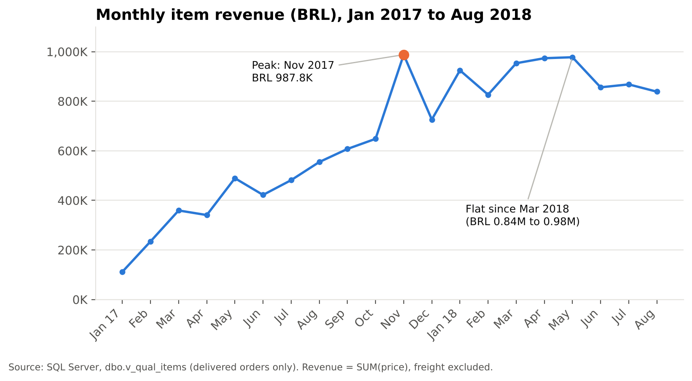
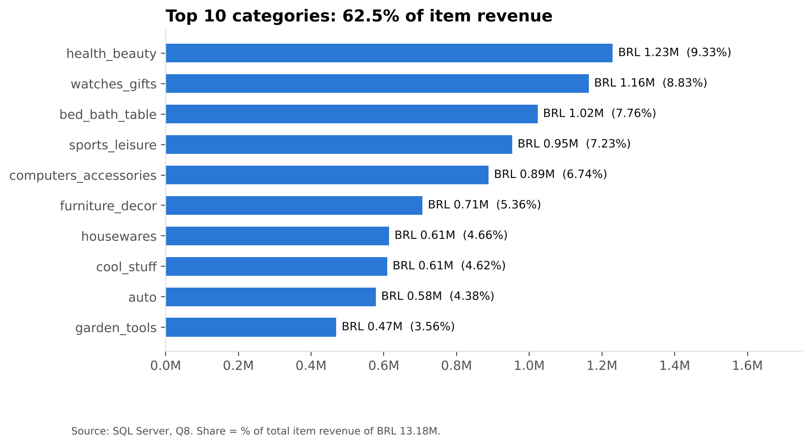
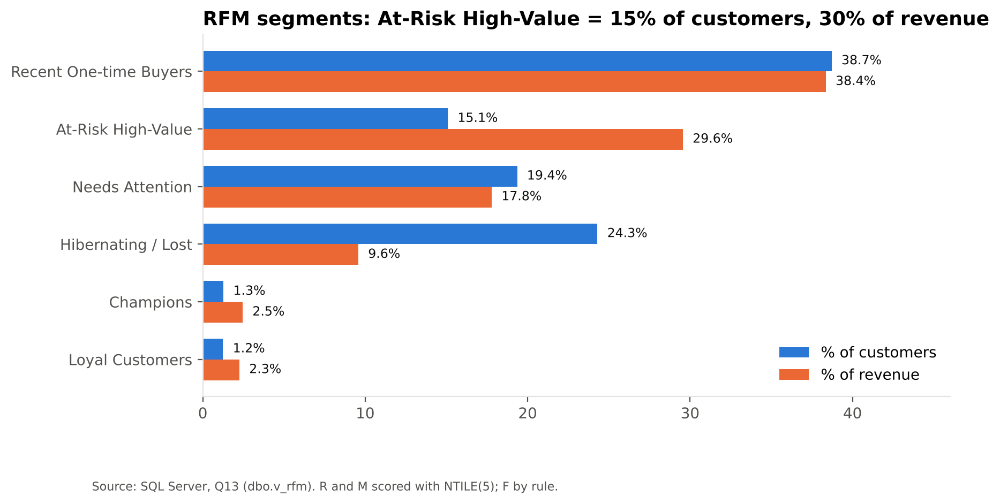
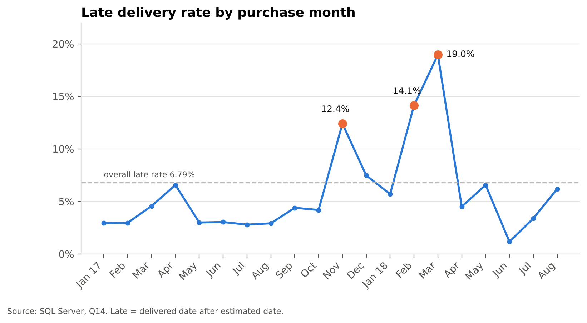
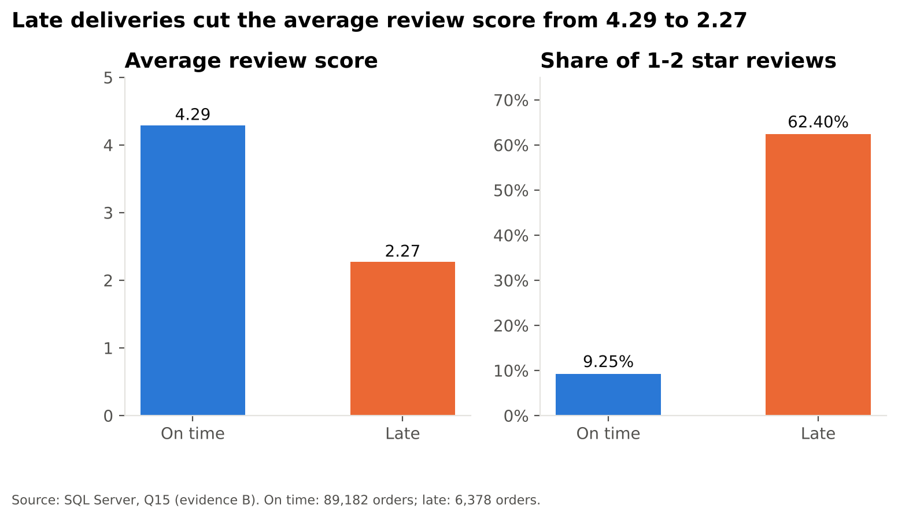

# Key Findings

E-commerce Business Performance & Customer Intelligence. Analysis of 96,211 completed orders (Jan 2017 to Aug 2018) from the Olist marketplace, built in SQL Server. Full answers: [BUSINESS_QUESTIONS_AND_ANSWERS.md](BUSINESS_QUESTIONS_AND_ANSWERS.md).

## Headline numbers

| Metric | Value |
|---|---|
| Completed orders | 96,211 |
| Customers | 93,104 |
| Item revenue | BRL 13.18M |
| Average order value | BRL 137.00 |
| Repeat customers | 3.00% |
| On-time delivery | 93.21% |

## The five findings that matter

**1. Growth has stalled.** Revenue peaked in November 2017 (BRL 987,765) and has not beaten it since. Quarterly growth slowed from +77.5% to +3.8%, and monthly revenue has stayed between BRL 0.84M and 0.98M since March 2018.

**2. Revenue is concentrated by geography and category.** SP, RJ and MG generate 63.4% of revenue, and ten categories generate 62.47%. SP has the highest revenue but the lowest average order value of all 27 states (BRL 125.12 vs BRL 137.00).

**3. Almost nobody comes back.** 97.00% of customers bought once, and only 3.00% repeat (2.15% on different days). Repeat customers spend BRL 260.08 vs BRL 137.91. A group of 14,053 lapsed high spenders holds 29.56% of revenue.

**4. Late deliveries wreck reviews.** 93.21% of orders arrive on time, but late orders average 2.27 stars vs 4.29 on time, and 62.4% of late orders get 1-2 stars. Late rates run from 4.50% (SP) to 21.46% (AL), and three months (Nov 2017, Feb and Mar 2018) produced about 48% of all late orders.

**5. Three large categories have review problems.** bed_bath_table (7.76% of revenue) rates 4.00 with 16.04% 1-2 star reviews and normal delivery; office_furniture rates 3.65 with the slowest delivery (20.5 days); telephony rates 4.05.

## Recommendations

| # | Opportunity | Evidence | Action |
|---|---|---|---|
| 1 | Reduce late deliveries in the worst states and peak months | 2.27 vs 4.29 stars; AL 21.46% late | Carrier SLAs, peak capacity plans, review promised dates in RJ, BA, MA, SE, AL |
| 2 | Convert one-time buyers to repeat customers | 97% buy once; repeaters spend 1.89x more | Second-purchase offer in 30 to 90 days; win-back for At-Risk High-Value |
| 3 | Fix review quality in large categories | bed_bath_table 4.00 stars; office_furniture 3.65 | Seller-level review audit; fix bulky-goods logistics |

Sizing is illustrative: each extra percentage point of repeat rate is about 931 customers, roughly BRL 114K at the observed spend gap.

## Data quality in one paragraph

All nine tables loaded in full with unique keys (except reviews: 551 orders have more than one, handled by keeping the latest). Joining raw reviews would have inflated revenue by 0.44%. 2.98% of delivery dates are missing (kept as NULL, never 0). A completed sale means delivered, with at least one item, purchased Jan 2017 to Aug 2018.

## Limitations

- Recency in the RFM analysis is measured against the dataset end date (Aug 2018), not today.
- "At-Risk" is a recency label, not a modelled churn probability.
- Findings such as late delivery and low reviews are correlations; the data cannot prove cause.
- Small states have unstable averages (for example AOV in states with under 100 orders).
- The dataset has no customer attributes and the identifiers are anonymised; no attempt was made to identify individuals.
- The analysis window (Jan 2017 to Aug 2018) leaves out 2016 and Sep-Oct 2018 on purpose.
- The sizing estimates in Q15 are illustrative assumptions, not forecasts.
